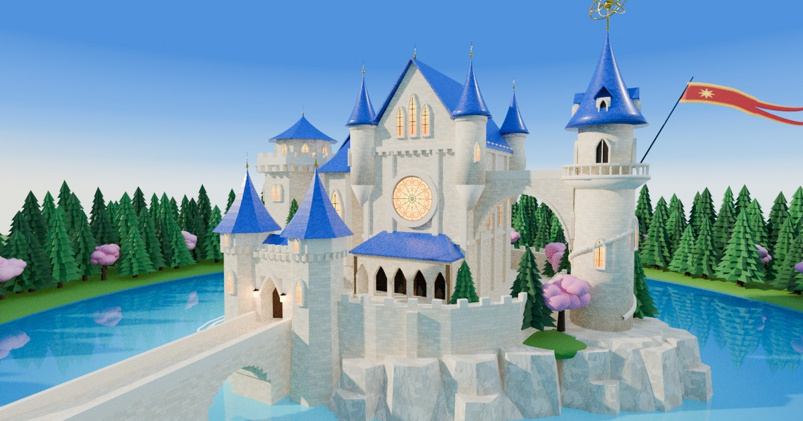
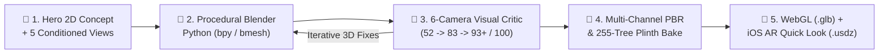

# 🏰 Schloss Aurelia - Generative 2D Concept to 3D & iPhone AR Diorama ✨

An end-to-end experiment turning a single generated 2D fairytale castle illustration into a verified, multi-angle **procedural 3D Blender scene**, an **animated WebGL `<model-viewer>` showcase**, and a **1-tap Apple iOS AR Quick Look (`.usdz`) tabletop diorama** - built via an autonomous **Modeler + Visual Critic** agent loop.

---

## 📱 Try It Live

* **🖥️ Desktop / Android / iOS WebGL:** Open the GitHub Pages site to orbit across 6 camera presets (`Castle Hero 3/4`, `Full Forest Diorama`, `Causeway & Gate`, `West Waterfall`, `Celestial Spire`, `Aerial Overview`) with real-time AgX tone-mapping.
* **🍏 iPhone & iPad AR Quick Look:** Tap **View on Table in iPhone AR** on the live page (even directly inside the X/Twitter iOS in-app browser) to place the animated **`92 cm` (`3 ft`) forested island citadel** onto your desk or coffee table at true tabletop scale.

---

## 🛠️ How We Built It

### 🎨 1. Multi-Angle Generative Reference Conditioning
Single-image-to-3D pipelines often hallucinate or flatten the back and sides of complex architecture. To lock a consistent 360° coordinate frame at the outset, we:
* Generated a **Hero 3/4 elevated castle concept** designed around distinct cardinal landmarks: an **East Celestial Spire** linked by a flying skybridge, a **West Octagonal Bastion** with a sluice portal and ribbed waterfall, a **South 3-Arch Flagstone Causeway & Barbican Gatehouse**, and a **North Stained-Glass Chapel Apse**.
* Conditioned **5 matching orthographic/aerial reference views** (`Front`, `East`, `West`, `Rear`, and `Top-Down Bird's-Eye`) directly on the hero illustration.

### 🔁 2. Closed-Loop Procedural Modeler + Independent Visual Critic (`52 -> 83 -> 93+ / 100`)
Instead of noisy photogrammetry or black-box mesh generation, a coding agent authored clean, modular **headless Blender Python (`bpy` / `bmesh`)** geometry while a separate **Visual Critic** audited side-by-side `[2D Reference | 3D Cycles Render]` contact sheets across all 6 cameras simultaneously:
* **Round 1 (`52 / 100` - Baseline):** Looked plausible from a single 3/4 angle, but the 6-view audit exposed classic 3D spatial bugs (e.g. stained-glass windows buried inside octagonal walls due to apothem math `R * cos(22.5°)`, coplanar Z-fighting on gatehouse piers, overlapping wall boxes, and shoreline trees photobombing elevation cameras).
* **Round 2 (`83 / 100` - Structural Upgrade):** Replaced overlapping boxes with mitered `bmesh` polyline curtain walls, carved open-water coves beneath all 3 causeway arches, built true 3D Gothic porch arcades and bronze window mullions, and fixed `WAVE -> SOLIDIFY` modifier ordering on the swallowtail banner.
* **Round 3 (`93+ / 100` - Certified Master):** Tuned sheer `82°` faceted dolomite cliffs, concentric open waterfall foam rings over shallow turquoise coves, 11-whorl alpine spruces, and balanced sky-dome hemisphere fill lighting across all shadow facades.

### 🌲 3. Weathered Multi-Channel PBR & 255-Tree Tabletop Plinth (`USDZ` + `GLB`)
Cycles procedural node graphs don't transfer directly to mobile AR runtimes, so we built an automated **Blender -> OpenUSD (`pxr`) + glTF 2.0** baking and framing stage:
* **🧱 26 Weathered PBR Texture Maps (`Albedo + Normal + Roughness`):** Synthesized coursed honey-ochre ashlar limestone with recessed dark mortar AO, damp mossy foundation masonry along the waterline and bridge piers, chiseled sandstone parapets/trim, 28-row imbricated Bavarian cobalt-slate roof shingles, and veined mossy cliff rock.
* **🌲 255 Surrounded Shoreline & Island Trees:** Preserved **232 surrounding shoreline spruces and cherry-blossom trees** plus **23 island trees** on a sculpted rolling alpine meadow bank and cobblestone approach road, using radial trunk-to-tip UVs (deep core AO `#0C2210` -> sunlit emerald needle tips `#3E7E36`).
* **🏛️ Watertight Museum Plinth & Live Motion:** Grounded the diorama onto a circular carved-sandstone and dark-bronze museum plinth (`91.6 × 91.6 × 24.0 cm`, `Y_min = 0.000 m`, `upAxis = Y`, `metersPerUnit = 1.0`) while preserving **192-frame (`8.0s @ 24fps`) keyframe animations** on the precessing golden astronomical armillary sphere, pulsing waterfall foam rings, and breeze-swaying island trees.

---

## 📦 Repository Contents

| File | Size | Description |
| :--- | :---: | :--- |
| `index.html` | `12 KB` | Responsive `<model-viewer>` WebGL showcase (`tone-mapping="agx"`, 6 camera presets, motion/turntable controls, and Apple `<a rel="ar">` Quick Look handoff) |
| `schloss_aurelia_ar.usdz` | `16.5 MB` | Self-contained OpenUSD `UsdPreviewSurface` package (`86` shader nodes, `255` trees, animated) for iOS/iPadOS AR Quick Look |
| `schloss_aurelia_ar.glb` | `22.3 MB` | Binary glTF 2.0 tabletop diorama with multi-channel PBR textures and keyframe animation for WebGL & Android Scene Viewer |
| `poster_hero.jpg` | `199 KB` | Instant-load poster frame & required first-child `` trigger for iOS Safari `rel="ar"` |
| `og_card_1200x630.jpg` | `164 KB` | Open Graph / X (`summary_large_image`) social preview card |
| `favicon.svg` | `1 KB` | Castle vector icon |
